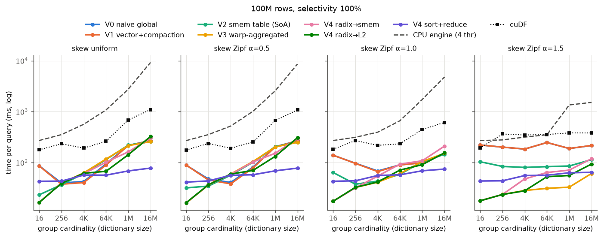
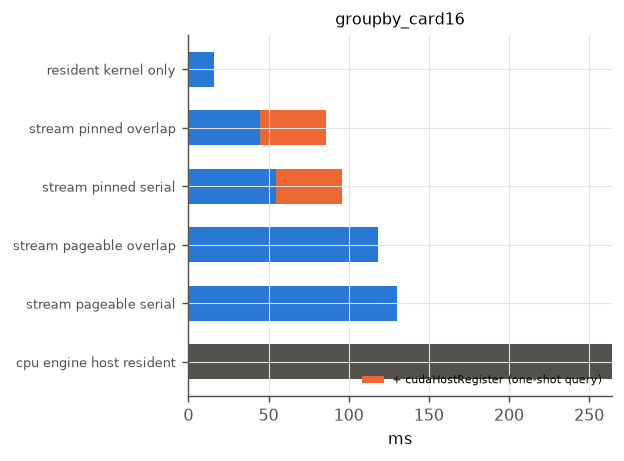
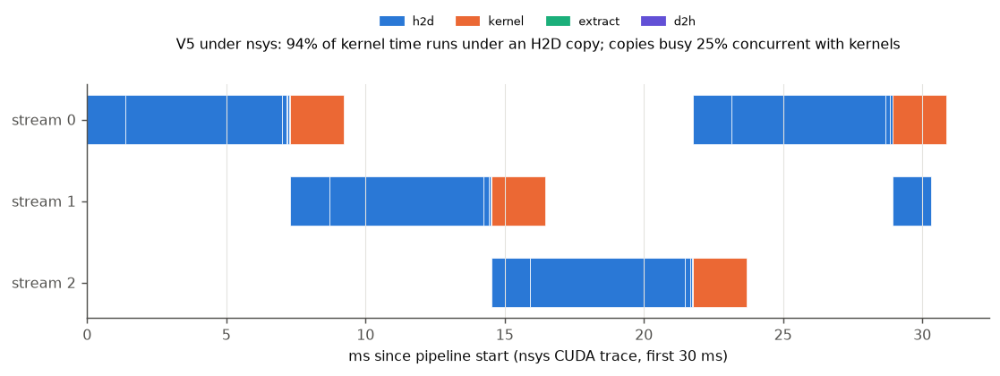
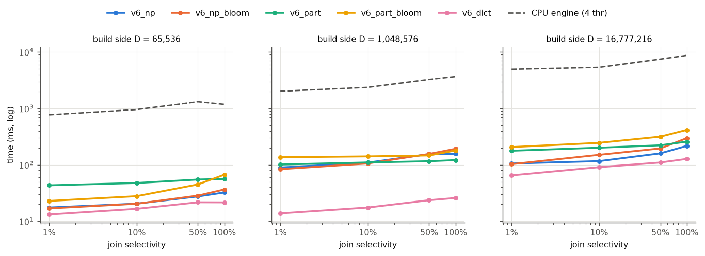
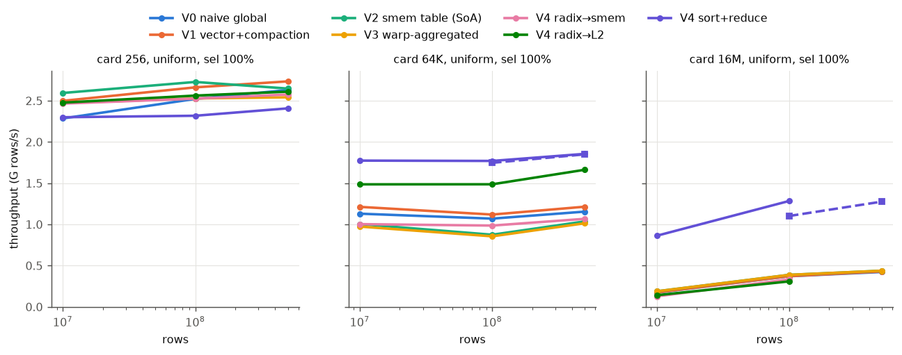
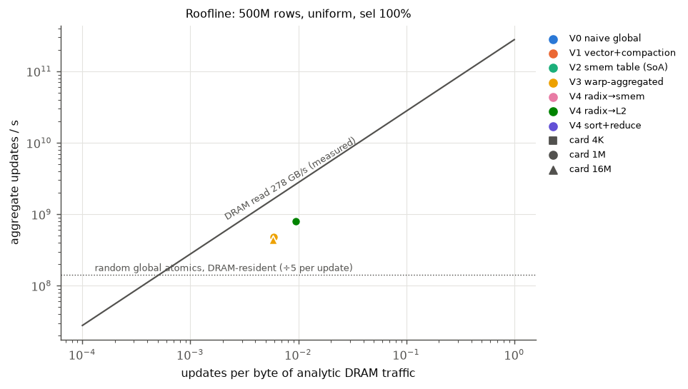

# RESULTS

**Question:** at what group cardinality, skew and selectivity does the GPU stop winning?

**Setup:** one Tesla T4 (40 SMs, 4 MB L2, 64 KB smem/SM, CUDA 12.8) against a 4-thread Xeon
@ 2.0 GHz (2 cores + HT, AVX-512) on Kaggle. Every number is a median of 30 timed runs after 5
warm-ups, timed with CUDA events. IQRs, SM/memory clocks, temperature and power are in
`results.json`. Every GPU result was diffed against the single-threaded CPU reference at
**every** sweep point before it was timed: 4,000+ measured points, 0 mismatches. All plots and tables
regenerate from `results.json` with `scripts/plot_all.py` (`plots/tables.md` holds every number).

Measured denominators (`bench micro`; the spec sheet is never used):

| quantity | measured |
|---|---|
| DRAM read bandwidth | **277.8 GB/s** (copy 226 GB/s) |
| PCIe H2D / D2H, pinned | 12.4 / 13.2 GB/s |
| PCIe H2D / D2H, pageable | 4.5 / 4.6 GB/s |
| random 64-bit global atomics, L2-resident (≤ 1 MB) | 29 G/s |
| random 64-bit global atomics, DRAM-resident (≥ 8 MB) | **0.72–1.08 G/s** |
| CPU read bandwidth, 4 threads (host memory) | 24.9 GB/s |

The 40× gap between L2-resident and DRAM-resident random atomics explains most of what follows.

## Headline: the crossover map

Best variant per point, 100M rows, selectivity 100% (speedup over the 4-thread CPU engine in parentheses):

| skew \ groups | 16 | 256 | 4K | 64K | 1M | 16M |
|---|---|---|---|---|---|---|
| uniform | V3 16.4 ms (17×) | V2 36.7 (10×) | V1 40.4 (14×) | **sort** 56.5 (19×) | **sort** 68.4 (40×) | **sort** 77.9 (119×) |
| Zipf 0.5 | V3 16.1 (17×) | V2 34.5 (10×) | V1 38.2 (14×) | **sort** 57.6 (18×) | **sort** 68.7 (37×) | **sort** 77.7 (111×) |
| Zipf 1.0 | V4-smem 17.3 (16×) | V4-smem 31.9 (10×) | V3 41.1 (10×) | **sort** 57.5 (12×) | **sort** 68.9 (25×) | **sort** 74.3 (64×) |
| Zipf 1.5 | V4-L2 17.7 (15×) | V4-L2 23.5 (12×) | V4-L2 27.8 (11×) | V3 31.1 (11×) | V3 32.8 (41×) | V3 60.9 (25×) |

(V4-smem and V4-L2 run plain V3 when their planner decides no partitioning is needed, which is
every ≤ 256-group point here. Their 16–256 numbers are V3's.)

What the map says:

1. **Below about 64K groups, hash aggregation wins.** The table fits in L2, and how you keep atomics off
   the hot slots decides the winner. Smem tables + warp aggregation (V2/V3) win at ≤ 256 groups.
   Plain global atomics (V1) win at 4K uniform, where a 256-slot smem table only adds an overflow
   probe.
2. **Above about 64K uniform groups, sort-based aggregation wins, by 2–3.5× at 1M–16M.** Every hash
   variant is then bound by random DRAM atomics (≈ 0.72 G/s measured, i.e. ≈ 140 M rows/s at five
   atomics per row). `cub` radix sort on the 2–3-byte dictionary codes streams at 107 GB/s instead.
3. **Skew moves the crossover far to the right.** At Zipf 1.5 the hot keys repeat inside each warp.
   `__match_any_sync` folds them, and V3 beats sort up to 1M groups.
4. **The GPU never loses to this CPU when data is resident**, but the margin varies 100×. At 1%
   selectivity, low cardinality, it is only **1.3–2×** (next section). At high cardinality it is
   40–119×, because the 4-thread CPU's partitioned hash aggregation is DRAM-latency bound.
5. **cuDF**, run on the same data uncompressed and device-resident, is **3.3–24× slower than the best
   variant (median 8.5×)**. Caveat: cuDF does more work. It reads ~2.8× the bytes (14 B/row
   uncompressed vs 5–9 B/row here), materialises the filtered frame, and runs a general groupby.
   This is a sanity anchor, not a fair race.

## Where the GPU stops winning

**(a) Low selectivity, low cardinality, data resident.** At 1% selectivity the CPU engine skips
unselected RLE runs entirely and never touches their codes or values. The GPU kernels decode the
predicate per row but still load every row's code and value. Result: GPU 4.0–4.9 ms vs CPU 6.4–11 ms at
100M rows, 16–4K groups (1.3–2.2×). Late materialisation (`v3_latemat`: decode the predicate first,
load a lane's data only if one of its rows survives) is the GPU fix. Measured in
[Late materialisation](#late-materialisation-v3_latemat).

**(b) PCIe is the wall (V5).** Data starts in host memory, 200M rows:

| query (200M rows) | CPU, host-resident | GPU pinned + 3-stream overlap | + one-time `cudaHostRegister` | GPU pageable | GPU kernel only (data on device) |
|---|---|---|---|---|---|
| global aggregate (no GROUP BY) | **76.6 ms** | 92.0 ms | 150.6 ms | 191.7 ms | 31.1 ms |
| GROUP BY, 16 groups | 564.7 | **116.5** | 190.2 | 230.8 | 32.2 |
| GROUP BY, 16M groups | 16,651 | 585.2 | 692.5 | **598.0** | 483.2 |

For the global aggregate **the GPU cannot win at all**. The bytes it must receive (4 B/row values + RLE)
take ≥ 68 ms at the measured 12.4 GB/s pinned PCIe floor. The CPU scans the same bytes from its own
memory at 24.9 GB/s, which is **twice PCIe**. That holds even if the GPU kernel took zero time. It gets
worse in practice: pageable memory halves PCIe (4.5 GB/s), and a one-shot query must pay
`cudaHostRegister` (59 ms here) to get pinned speed. The GPU only wins once there is enough work per
byte. Already at 16 groups the CPU engine's per-row hash update makes it 5× slower than the
PCIe-bound GPU. At 16M groups the GPU kernel itself (483 ms) dominates and PCIe disappears
behind it.

Compression is what keeps the GPU in the game here. Dictionary codes ship 1 B/row instead of an 8-byte
key, and RLE ships the predicate column at 6 B per ~32 rows. Uncompressed, the same group-by would
move 14 B/row and hit the PCIe floor at ~226 ms.

Overlap evidence (`nsys`, installed at run time; the event-timeline equivalent is
`plots/timeline_*.png`):

In the 3-stream pinned pipeline the copy engine runs H2D chunks back to back, and **94% of kernel
time runs underneath a copy**. The pipeline is copy-bound, which is the point of (b). Serial
(1 stream) vs overlapped costs 135 → 117 ms (16 groups). 2, 3 or 4 streams are within 5% of each
other (one H2D copy engine is the bottleneck), and chunk size (1M–64M rows) moves it < 10%.

**(c) Hash table sized by dictionary, few surviving rows.** At 1% selectivity and 16M groups, every
hash variant spends ~30 ms clearing and scanning a 2 GB table (capacity = 2 × dictionary size,
fixed for all variants as the brief requires) for ~100K surviving rows. The CPU engine (sized by what it
inserts) takes 8 ms there (10M rows). Sort-based aggregation does not care (0.6 ms). Sizing the table from
the planner's selected-row estimate is measured as a separate experiment:
[Capacity policy](#capacity-policy-capest).

## The ladder, rung by rung

Numbers are 100M rows unless stated. Full per-point tables are in `plots/tables.md`.

**V0: naive global hash aggregate.** Open addressing, linear probing, read-then-64-bit-`atomicCAS`
claim, one atomic per aggregate, one row per lane, scalar loads, fused RLE + dictionary decode. It is
correct and reasonable, and it is the reference every other rung is measured against. Its failure
modes are the textbook ones. With 16 uniform groups, 100M rows serialise on 16 slots: 85 ms, vs 16 ms
for V3. At Zipf 1.5 it is 184–247 ms at every cardinality. With 1M+ groups it is bound by random DRAM
atomics: 219–272 ms. A layout lesson came from this rung too. The natural `struct Slot` (AoS, 64 B
aligned) is 2–3× faster than structure-of-arrays once the table outgrows L2: one line per update
instead of six (64K groups: 88 vs 283 ms; 1M: 219 vs 758 ms). It is 1.8–2.4× *slower* under hot-key
contention, because all five atomics of a hot slot queue on one L2 line (16 groups: 85 vs 47 ms;
Zipf 1.5: 221 vs 94 ms). The AoS layout is the default because V3 removes that contention. SoA stays
as the `v0_naive_soa` ablation.

**V1: coalescing, vector loads, ballot compaction.** 16-byte loads (4 rows/lane, 128 rows per warp
step), the predicate turned into 4 ballots, survivors compacted through a per-warp shared ring buffer
with `__popc` prefix offsets, so the probe phase always runs 32 lanes wide. It bought **1.4–1.8× at 1%
selectivity, 1.2–1.5× at 10%, and ≤ 1.2× at 50–100%** (uniform, 16–64K groups). At low
selectivity the kernel is a scan, and wide loads plus less warp divergence win. At high selectivity
the atomics dominate and every lane was already busy. The compaction half of V1 bought ≤ 11% even at
10% selectivity (`v1_nocompact` ablation). See FAILURES.md.

**V2: shared-memory private tables.** Block-private open-addressing table (load factor capped at
0.5, 16-probe limit, overflow to the global table, block-level merge at the end).

*Bank conflicts, measured explicitly.* A 64-byte AoS slot (the cache-line bucket you would choose for
a global table) puts every key at word offset 16·s, so only 2 banks are ever used. Microbenchmark,
512-slot table, random slots, cycles per warp instruction: key probe **604 (AoS-64) vs 192 (SoA)**;
u32 atomicAdd 584 vs 113; u64 atomicAdd 4,560 vs 869. A Monte-Carlo bank model predicts 18.9 vs 6.0
wavefronts per warp. The fix is the SoA layout change. In the full kernel (V2, 512 slots) it is worth
**49.2 → 29.1 ms at 16 groups** and 58.5 → 47.6 ms at 256, and nothing above 4K groups, where the
smem table is overflowed anyway.

*What V2 bought.* 3.7× over V1 at 16 uniform groups, 2.1–3.0× at Zipf 1.5 for every cardinality.
It is *slower* than V1 at 4K–64K uniform (0.67–0.78×): those tables still fit L2, global atomics are
cheap there (29 G/s), and the smem table only adds an overflow probe. Two more costs were found on
the way. (1) Occupancy: a 1024-slot table + warp buffers is 52 KB, so 1 block/SM. 256 slots runs
2 blocks/SM: V3 is 1.3× faster at 16 groups and 1.1–1.4× under Zipf 1.5. But at exactly 256 uniform
groups, the 1024-slot table (which holds them all) is 1.2× faster than 256 slots (which overflow
their 128-key budget). 256 is the default (ablations `v2_smem_soa1024`, `v3_warpagg512/1024`). (2) 64-bit and double shared atomics are compare-and-swap
loops on sm_75 (≈ 8× a 32-bit atomic), and four of the five aggregates are 64-bit.

**V3: warp-aggregated atomics.** `__match_any_sync` groups lanes holding the same key, a
log2(group)-round shuffle tree folds their five aggregates, and only the leader touches the table.
Speedup over V1:

| groups | 16 | 256 | 4K | 64K | 1M | 16M |
|---|---|---|---|---|---|---|
| uniform | **5.2×** | 0.95× | 0.65× | 0.76× | 1.0× | 1.0× |
| Zipf 1.0 | 8.0× | 3.0× | 1.6× | 1.5× | 0.94× | 0.98× |
| Zipf 1.5 | **12.5×** | 8.5× | 6.5× | 8.0× | 5.8× | 3.6× |

As expected, it is enormous at high skew and does nothing for uniform keys once groups ≫ 32 (a warp
almost never holds a duplicate). At uniform 4K–64K the `__match_any_sync` + reduction cost is pure
overhead on top of V2's (−25–35%). It is the decisive rung on real data: TPC-H Q1 has 4 groups, so
V0–V2 take 143–176 ms and V3 takes **9.4 ms**.

**V4: radix partition, then aggregate.** Rows are partitioned (1–2 passes, ≤ 256-way per pass) on the
top hash bits. *smem* mode sizes partitions to ≤ 256 groups and aggregates each in a block-private
table. *L2* mode partitions only until each partition's slice of the global table is ≤ 1 MB, then
uses warp-aggregated global atomics; partition id = top hash bits = home-slot bits, so each partition
touches a contiguous slice. Phase timers (`info.ms_*` in results.json) separate the costs. The
partition pass was first a naive per-row scatter, ~10× its byte volume (see FAILURES.md). With
shared-memory write-combining it is 2.3–2.5× cheaper (64K groups: 218 → 97 ms; 16M: 333+197 →
197+80 ms for two passes).

*Cost vs contention saved.* Uniform keys, best V4 mode vs best non-partitioned hash variant (V1–V3):

| groups | 4K | 64K | 1M | 16M |
|---|---|---|---|---|
| best V1–V3 | 40.4 ms | 89.4 | 214.8 | 257.8 |
| best V4 (mode) | 60.2 (smem) | **67.3** (L2) | **142.5** (L2) | 300.3 (smem) |

V4 pays off only in the **64K–1M band (1.3–1.5×)**. There the partition pass turns random DRAM
atomics into L2-resident ones. At 4K the table already fits L2, so partitioning is pure overhead. At
16M, two passes over 16M distinct keys cost more than the atomics they localise. L2 mode (one
cheap partition pass, table slices ≤ 1 MB) beats smem mode everywhere except 16M, and is the best
variant at Zipf 1.5 / ≤ 4K groups (27.8 ms vs 47.6 for smem mode at 4K).

*Sort-based (`v4_sort`).* Compaction (fused decode + filter, warp-aggregated append) →
`cub::DeviceRadixSort` on the **dictionary code** (log2(card) bits: 1 digit pass at 256 groups, 3 at
16M) → `cub::DeviceReduce::ReduceByKey` → decode only the unique codes. It is flat in cardinality
(43–78 ms over 16 → 16M groups at 100M rows) and wins every uniform point ≥ 64K. It loses at low
cardinality (43 ms vs 16 ms at 16 groups), where it sorts 100M rows to produce 16 groups. Sorting
codes instead of keys is a compressed-data win: 3–4 bytes and ≤ 24 key bits instead of 8 bytes and
64 bits.

**V5: streaming pipeline.** Covered in [Where the GPU stops winning](#where-the-gpu-stops-winning) (b).
Chunked H2D on ≥ 3 streams with pinned memory overlaps fully with the aggregation kernel (nsys: 94%
of kernel time under copies). The result is extracted table-slice by slice and copied D2H on the
same rotating streams, so extraction of slice j+1 overlaps the copy of slice j. Deliberate negative
result: when per-byte work is low, the GPU's end-to-end time is the PCIe floor. A CPU with 2× PCIe
memory bandwidth (24.9 vs 12.4 GB/s here) wins no matter how fast the kernel is.

**V6: hash join + aggregate.** 100M-row fact table, dimension D ∈ {64K, 1M, 16M}, join selectivity =
fraction of dimension rows passing `d.p < sel`, then `GROUP BY d.cat` (64 groups, V3-style
aggregation).

| D | sel | non-part. | + Bloom | partitioned | part. + Bloom | **dictionary-translated** | CPU (4 thr) |
|---|---|---|---|---|---|---|---|
| 64K | 1% | 17.6 ms | 16.9 | 43.4 | 23.0 | **13.2** | 773 |
| 64K | 100% | 32.4 | 36.6 | 56.3 | 66.9 | **21.7** | 1,181 |
| 1M | 1% | 89.8 | 83.9 | 101.6 | 136.5 | **13.8** | 2,023 |
| 1M | 50% | 155.2 | 156.3 | 116.0 | 146.9 | **23.7** | 3,270 |
| 1M | 100% | 157.4 | 193.0 | 121.4 | 180.1 | **25.9** | 3,675 |
| 16M | 1% | 105.6 | 103.0 | 178.2 | 207.1 | **65.1** | 4,944 |
| 16M | 100% | 217.4 | 297.9 | 258.1 | 417.5 | **127.5** | 8,730 |

- *Bloom filter (blocked, one 32-bit word and 4 bits per key, 16 bits/key; measured FPR 0.00–0.18%).*
  Measured saving: 4–7% at 1% selectivity, but a 13–37% *loss* at 100% (every probe pays the
  filter for nothing). The filter skips the hash-table probe. It does not skip the fact-code → key dictionary
  gather, which is half of the probe cost. With partitioning the filter also costs a second gather
  in the histogram pass, so `part_bloom` loses almost everywhere.
- *Partitioned vs not.* Probe-side partitioning (staged, on the build table's home-slot bits,
  partitions visited in order → the active table slice is L2-resident) wins only at D = 1M with
  ≥ 50% selectivity (116 vs 155 ms; 121 vs 157 ms). There the 18 MB build table is too big for L2
  but its 1 MB slices are not. At 16M it pays the random dictionary gather twice (histogram + scatter) and
  loses.
- *Dictionary-translated join* is the compressed-data result. The fact key is dictionary-encoded, so
  probe the D dictionary entries once, build a code → cat byte array, and scan the fact table with a
  1-byte gather per row. It wins every point: 1.3–6.1× over the best row-wise join, and 54–147× over the
  CPU engine at D ≤ 1M. Its cost scales with D, not F, so at D = F it would converge to the plain join.

## Real data: TPC-H SF-10 lineitem (60M rows)

Generated by DuckDB `dbgen`, stored sorted by `l_shipdate`, so the date run-length-encodes to 2,526
runs (~24K rows/run), the way a clustered fact table would. The prices are exact cents, and the
composite key `(l_returnflag, l_linestatus)` is two dictionary columns. The reference answer matches
**DuckDB's** answer for the same SQL exactly (count/sum/min/max). The table below is the *shaped*
Q6, the date predicate only, run by the generic engine. The full Q6, with all three predicates, follows
after it.

| | Q1-shaped (4 groups, 98% selected) | Q6-shaped (1 group, 15% selected) |
|---|---|---|
| V0 naive | 175.9 ms | 43.7 |
| V1 | 174.5 | 43.2 |
| V2 (SoA) | 143.4 | 21.7 |
| **V3 warp-aggregated** | **9.4** | **3.4** |
| V4 sort | 23.8 | 4.8 |
| CPU engine (4 thr) | 199.8 | 50.0 |
| cuDF (uncompressed, device) | 110.0 | 23.6 |
| DuckDB (4 thr, its own storage) | 730.0 | 30.7 |

With 4 groups and ~59M qualifying rows, Q1 is a pure contention benchmark. Warp aggregation is a
**15×** step (V2 → V3; 19× over V0) and 21× over the CPU engine.

**Full TPC-H Q6** (`SUM(l_extendedprice * l_discount)` with the date-year, discount 0.05–0.07 and
quantity < 24 predicates). It uses a dedicated kernel because the generic engine has one predicate
column. Revenue is exact int64 (cents × percent): 1,230,113,636.0101, matching DuckDB on the encoded
columns. `tpch_prep.py` asserts that this equals the official Q6 SQL over DuckDB's DECIMAL columns, and
that cuDF's answer is equal too. 1,139,264 of 60M rows qualify (1.9%); the date alone passes ~15%.

| full Q6, SF-10 | ms | vs CPU engine |
|---|---|---|
| GPU, eager (load date runs + discount + quantity + price for every row) | 1.49 | 11.4× |
| **GPU, ordered/late** (date from RLE → discount + quantity only where the date passes → price only where all pass) | **1.06** | **15.9×** |
| CPU engine (4 thr, skips runs whose date fails) | 16.9 | 1× |
| DuckDB (official SQL, DECIMAL columns) | 26.1 | 0.65× |
| cuDF (device-resident, materialised filter) | 35.9 | 0.47× |

The eager kernel reads 6 B/row and runs at 87% of measured DRAM bandwidth, so it is at the roofline.
Ordering the predicates by cost lets the kernel skip whole 128-row strips of discount, quantity and price.
On sorted data the date predicate rejects ~85% of rows in long runs, so the late form reads less than the
eager form's byte count would allow at full bandwidth (an effective 122% if charged the eager bytes).
That is the same late-materialisation result as `v3_latemat`, on real data with multiple predicates.
(Measured in the follow-up session, `runs/20261011T202316Z`.)

## Scale (10M → 100M → 500M rows)

Best correct variant, 100M → 500M rows (CPU = 4-thread engine; throughput = input rows / time):

| groups | skew | sel | 100M best | 500M best | GPU/CPU 100M → 500M |
|---|---|---|---|---|---|
| 16 | uniform | 100% | v3_warpagg 16.4 ms (6.1 G rows/s) | v4_radix_l2 76.4 ms (6.5 G/s) | 16.5× → 17× |
| 16 | uniform | 1% | v1_vec 4.0 ms | v1_vec 16.0 ms | 1.6× → 2.1× |
| 256 | uniform | 100% | v2_smem_soa 36.7 ms | v1_vec 182.8 ms | 9.7× → 10× |
| 4K | uniform | 100% | v1_vec 40.4 ms | v1_vec 190.7 ms | 14× → 16× |
| 4K | Zipf 1.5 | 100% | v4_radix_l2 27.8 ms | v4_radix_l2 130.3 ms | 11× → 11× |
| 64K | uniform | 100% | v4_sort 56.5 ms (1.8 G rows/s) | v4_sort 269.4 ms (1.9 G/s) | 19× → 21× |
| 64K | Zipf 1.5 | 100% | v3_warpagg 31.1 ms | v3_warpagg 135.6 ms | 11× → 12× |
| 1M | uniform | 100% | v4_sort 68.4 ms (1.5 G/s) | v4_radix_l2 628.9 ms (0.8 G/s) | 40× → 24× |
| 1M | Zipf 1.5 | 100% | v3_warpagg 32.8 ms | v3_warpagg 140.3 ms | 41× → 56× |
| 16M | uniform | 100% | v4_sort 77.9 ms (1.3 G/s) | v3_warpagg 1140.9 ms (0.4 G/s) | 119× → 35× |
| 16M | uniform | 1% | v4_sort 5.7 ms | v1_vec 58.8 ms | 21× → 13× |
| 16M | Zipf 1.5 | 1% | v4_sort 4.9 ms | v1_vec 48.0 ms | 3.6× → 2.0× |

**Scaling is linear wherever the plan stays the same.** At ≤ 64K groups, and wherever V3 wins
(skew), time grows 4.0–5.0× for 5× the rows. Throughput holds or rises slightly, because launch and
extraction costs are amortised. The CPU engine scales the same way, so the GPU/CPU ratio holds or
improves a little (1% selectivity: 1.4–2.2× → 1.6–2.4×). The winner sometimes changes between 100M
and 500M at ≤ 4K groups (e.g. V3 → v4_radix_l2 at 16 groups). These are near-ties: the top two are within 0.1–3.3%,
all scan-bound, so the label flips while the time does not. All 432
points at 500M / 16–4K groups are timed and correct, with no OOM skips: at ≤ 4K groups the partition
and sort buffers still fit.

**It breaks where memory capacity changes the plan.** At 500M rows the out-of-place algorithms no
longer fit in the T4's 15 GB alongside the ~4 GB of columns (u32 codes + int32 values):
- `v4_sort` needs double-buffered keys and values plus cub's temp space, and it is skipped at 1M and 16M groups.
- `v4_radix_smem` and `v4_radix_l2` need a full partitioned copy of the selected rows. Both are
  skipped at 16M groups, and `v4_radix_smem` is also skipped at 1M.

These are recorded as `skip: oom:*`, with no time reported. The in-place hash variants then win by
default, and they are back to random DRAM atomics into a 16M-group table. At 16M uniform groups,
throughput drops 3.3× (1.3 → 0.4 G rows/s). The GPU's lead over the CPU falls from 119× to 35×, and to
2.0× at Zipf 1.5 / 1% selectivity. That is a fourth answer to "where does the GPU stop winning": **when
the working set of the best algorithm no longer fits in device memory.** 352 of the 432 points at
500M/high cardinality are timed and all are correct; the other 80 are the OOM skips above.

**Fix: `v4_sort_chunked`** (follow-up session). The plan is the same compaction + radix sort +
ReduceByKey, but over row chunks sized to fit free memory. Each chunk's (unique code, partial
aggregate) runs fold into a dense per-code accumulator (card × 32 B). Codes are unique within one
chunk's output, so the fold is a plain load–merge–store with no atomics. The planner uses the exact
selected-row count from the RLE statistics. If those rows fit, there is one chunk with buffers sized to
the selected rows only; that alone fixes every 1–10% point. Otherwise it uses 3–5 chunks. It is checked
like every variant, plus a forced 4,096-row-chunk verify and memcheck/racecheck. All 84 timed points of
that run are correct.

| 500M rows, sel 100% | best that fit before | v4_sort_chunked | speedup | G rows/s | GPU/CPU |
|---|---|---|---|---|---|
| 1M groups, uniform | v4_radix_l2 628.9 ms | **338.8 ms** (3 chunks) | 1.86× | 1.5 | 24× → **45×** |
| 16M groups, uniform | v3_warpagg 1140.9 ms | **391.9 ms** (5 chunks) | 2.91× | 1.3 | 35× → **101×** |
| 16M groups, Zipf 1.0 | v2_smem_soa 528.5 | **380.7** | 1.39× | 1.3 | 40× → 55× |
| 16M groups, Zipf 1.5 | **v3_warpagg 174.1** | 324.6 | 0.54× | | V3 stays |

This restores linear scaling: 16M uniform runs at 1.3 G rows/s at 500M, the same as v4_sort at 100M.
Over the 48 points at 500M / 64K–16M groups it beats the previous best at every point with
skew ≤ 1.0 and ≥ 1M groups (1.01–2.91×). It ties within ±5% at 64K / skew ≤ 1.0, where v4_sort already
fit. At Zipf 1.5 it wins only at 16M groups with 1–10% selectivity (1.10–1.61×), and otherwise ties or loses
(0.43–1.00×). V3's warp aggregation turns a few hot keys into few atomics, and sorting cannot
exploit that. So the planner rule is unchanged, with the OOM gap closed: **sort for
uniform high cardinality, warp aggregation for heavy skew.** Chunking costs ≤ 2% at 64K–1M groups. At
16M groups it adds 7–11 ms of fixed cost: initialising and scanning the 512 MB accumulator (100M rows:
15.0 → 25.8 ms at 10%, 79.0 → 90.7 ms at 100%). Forcing six 16M-row chunks at 100M costs another
+0–35 ms (`plots/tables.md`). Cross-session comparisons carry the ~6% session noise measured in the
capacity section.

## Late materialisation (v3_latemat)

`v3_latemat` is V3 with one change in the front end (`FE_VEC_COMPACT_LATE`). The warp decodes the
RLE predicate for its 128 rows first. A lane then issues its 16-byte code and value loads only if at
least one of its 4 rows survives. Runs average 32 rows, so at 1% selectivity whole 128-row strips
fail, and their sectors are never fetched. It is a separate, verified run (916 checks + checker
self-test, 0 failures); 100M rows, uniform and Zipf 1.5, all 96 points correct.

| v3_warpagg → v3_latemat, 100M rows | sel 1% | 10% | 50% | 100% |
|---|---|---|---|---|
| 16 groups, uniform | 4.16 → **2.51 ms** (1.66×) | 5.11 → 4.22 (1.21×) | 0.99× | 0.98× |
| 4K groups, uniform | 4.88 → **3.13** (1.56×) | 10.49 → 9.20 (1.14×) | 1.01× | 1.02× |
| 64K groups, uniform | 5.78 → **3.93** (1.47×) | 1.17× | 1.03× | 1.00× |
| 1M groups, uniform | 8.17 → 6.00 (1.36×) | 1.07× | 1.01× | 1.01× |
| 16M groups, uniform | 36.3 → 34.0 (1.07×) | 1.03× | 1.01× | 1.00× |

It wins 1.36–1.66× at 1% selectivity up to 1M groups, about 1.15× at 10%, and nothing at ≥ 50%. At
≥ 50% almost every 128-row strip has a survivor, so the loads happen anyway, and the extra branch
costs ≤ 3%. This closes gap (a): against the CPU engine at 1%, the GPU goes from 1.3–2.2× to
**2.4–3.5× at 16–4K groups**. It also beats `v4_sort` at 64K / 1% (3.9 vs 4.9 ms). At 16M groups the
2 GB dictionary-sized table dominates, so late loading cannot help. That is gap (c), next section.
**In a planner: use late materialisation when the estimated selectivity is below ~25%; it is free
otherwise.**

## Capacity policy (cap=est)

The main sweep sizes every hash table at 2 × dictionary size (`cap=dict`), so all variants see the
same table. `cap=est` instead sizes it at 2 × min(dictionary, estimated selected rows). The estimate
comes from the RLE predicate column (`rle_count_selected`, exact and cheap). This was re-run for all
nine main variants at 10M and 100M rows, 64K–16M groups, uniform and Zipf 1.5 (432 points, all
correct).

Capacity only changes where the dictionary is much larger than the selected rows. At 100M rows that
is 16M groups at 1% selectivity (32M → 2M slots; load factor 0.029 → 0.467 uniform):

| 16M groups, sel 1%, 100M rows | uniform cap=dict → est | Zipf 1.5 cap=dict → est |
|---|---|---|
| v0_naive | 36.8 → 9.5 ms (3.9×) | 33.9 → 7.2 (4.7×) |
| v1_vec | 35.7 → **7.9** (4.6×) | 33.3 → **5.8** (5.8×) |
| v3_warpagg | 36.2 → 8.5 (4.3×) | 33.7 → 6.1 (5.5×) |
| v4_sort (no table) | 5.7 → 5.4 | 4.9 → 4.7 |

The ~28 ms saved is the fixed cost of clearing and then scanning a 2 GB table (32M × 64 B AoS slots,
at least 4 GB of DRAM traffic before any row is processed). The probes themselves were never the cost. Even so, `v4_sort` still wins this
cell at 100M rows: correct sizing makes hash aggregation competitive, but not faster. At 10M rows the
effect is larger (v3_warpagg 29.9 → 0.8 ms at Zipf 1.5, 40×), because the fixed table cost dominates
a smaller scan.

Everywhere the capacity did not change (342 of the 432 points), the cap=est session ran a median 6%
faster (p95 1.22×). That is session-to-session clock and power-cap drift (the T4 was power-capped in
96% of points), and it is the noise floor for comparing different Kaggle sessions. All cross-session
ratios here should be read against it; same-session comparisons such as the latemat table are not
affected. Not measured: cap=est at 500M rows. That is where it would matter most, because there
`v4_sort` runs out of memory at ≥ 1M groups and the hash variants are the only option ([Scale](#scale-10m--100m--500m-rows)).
**In a planner: size from the selectivity estimate. Correctness does not depend on it (open addressing
with an exact count bound), and it can only shrink the table.**

## Roofline

x = aggregate updates per byte of *analytic* DRAM traffic for that variant, counting the compulsory
scan, dictionary gathers when the dictionary exceeds L2, hash-table sector traffic, partition passes
and sort passes (model in `plot_all.py: dram_traffic`). y = updates/s. Diagonal = measured 278 GB/s.
At 100M rows, uniform, sel 100%:

| variant | 4K groups | 1M | 16M |
|---|---|---|---|
| V3 (hash) | 4% of DRAM BW | 28% | 27% |
| V4 radix-smem | 22% | 29% | 21% |
| V4 sort | 34% | 38% | 39% |

At 4K groups all hash variants are far below the roof (≤ 6%). They are bound by atomic
serialisation and shared-memory atomic cost, not memory. At ≥ 1M groups the hash variants move
~17–19 GB per query (≈ 2 random 32 B sectors per row) at ~75 GB/s. That is the random-access
efficiency of GDDR6 on this part, about 27% of the streaming bandwidth. Sort moves less than half
the bytes (8.4 GB) and streams them at ~39% of the roof, which is why it wins.

## Correctness and determinism

- Every variant at every point is checked on the device against the CPU reference (sorted by key):
  key set, COUNT, SUM (int64), MIN and MAX must match **exactly**. The reference is a different
  algorithm (dense dictionary-code arrays, no hashing), so a shared hashing bug cannot hide.
  `make verify` additionally runs 5,000+ edge-case checks (1, 4,099 and 1,000,003 rows, selectivity
  0%, all key widths, composite keys, joins) and an injected-error self-test of the checker, then
  `compute-sanitizer` memcheck (0 errors, 0 leaks) and racecheck (0 hazards). `v3_latemat` was added
  later and has its own pass (`make verify-latemat-san`, selectivity 1/10/100% so the skipped-load path
  runs): 76 checks, memcheck 0 errors, racecheck 0 hazards.
- **MIN/MAX** are integer and order-independent, so they are deterministic.
- **The floating-point SUM (`SUM(v*0.01)` in double) is not deterministic** on the GPU. Atomic and
  warp-shuffle reduction order varies from run to run, and sort-based aggregation reduces in an order
  that depends on the non-deterministic compaction. It is compared with a relative tolerance of 1e-9.
  The largest error seen over all 3,432 timed sweep, ablation, capacity and latemat points was **1.7e-10**, median 6e-13; no
  point was bit-identical to the sequential reference. The int64 SUM is exact.
- Load factor: capacity = nextpow2(2 × dictionary size) for every variant, so the reported load factor
  (groups/capacity) is ≤ 0.50 at every point (min 9e-5 when few groups survive).

## Measurement notes

- **Clocks.** The T4 ran under its software power cap (NVML throttle reason 0x4) for 96% of
  measurements. SM clock after a measurement ranged from 450 to 1,590 MHz (median 1,185), at
  72–84 °C. Steady-state throttling is how a 70 W T4 runs, so medians reflect it. Clocks are stored
  per point, and IQR/median is 1.6% at the median point.
- **Profilers.** `ncu` is blocked on Kaggle (`ERR_NVGPUCTRPERM`), so nothing here uses hardware
  counters. Occupancy comes from the occupancy API (stored in `info`), bytes are analytic, and
  bandwidth is our own microbenchmark. Under `ncu` the bandwidth kernel measured 150 GB/s instead of
  278, so never time under a profiler.
- **CPU baseline.** `-O3 -march=native`, all 4 hardware threads. Thread-local hash tables at ≤ 64K
  groups. Radix-partitioned two-phase aggregation above that, with partitions sized to the core's L2.
  It hashes decoded keys like the GPU does. The weak absolute CPU numbers reflect a 2-core VM, so
  speedups are "vs this CPU" only.
